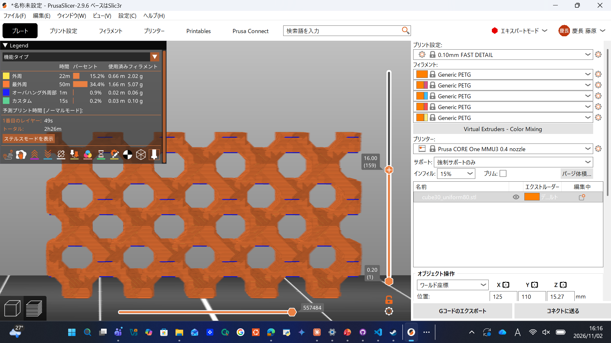
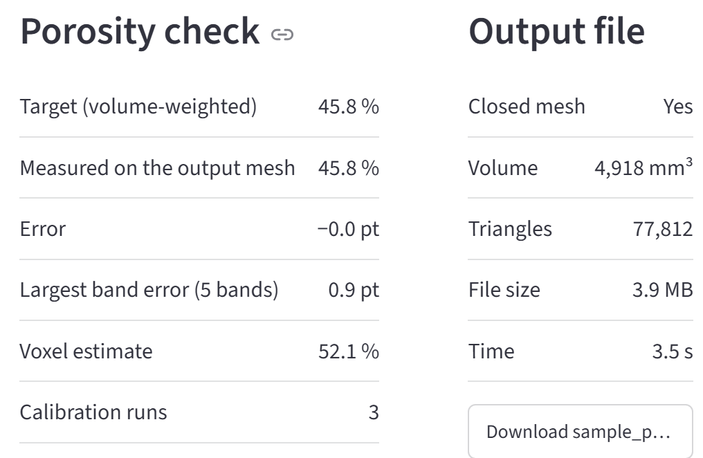
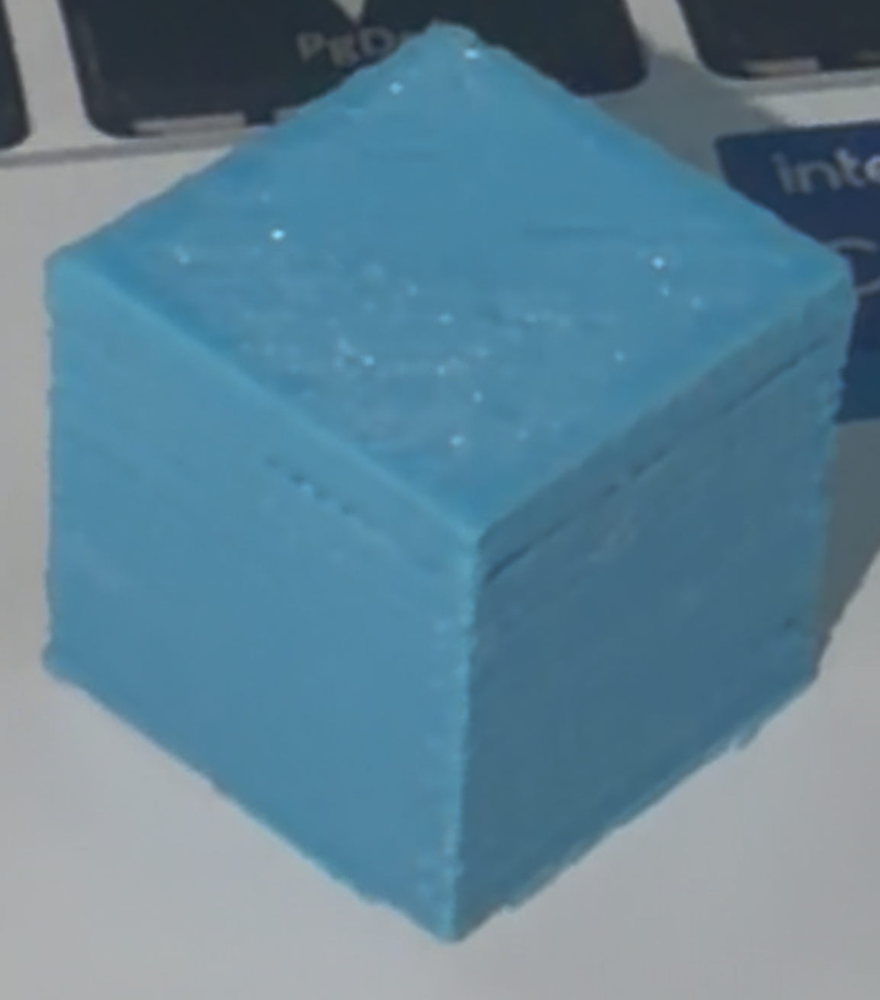

# Technical report: Porous Structure Generator for 3D Printing

Yoshinaga Fujihara and Ayumu Takahashi
IIT Madras, November 2026

Repository: https://github.com/susi0099/porous-generator (engine at tag `v1.0`)

## 1. Introduction

### 1.1 Background

Porous parts are useful for light structures, filters and medical implants.
In CAD tools such as SolidWorks they are very hard to make. Each pore has to be modelled by hand,
a part needs thousands of pores, the file becomes heavy, and a new porosity means starting again.

### 1.2 Purpose

We built a Python tool that needs only one number. The user gives a closed STL and a porosity,
for example 50 %, and gets a porous STL with the same outer shape.
Instead of making pores one by one, the inside is filled with a gyroid lattice,
which is defined by one formula (Chapter 2). The tool can be used from a web app (`app.py`)
or from the command line (`python -m porous`).

The tool also supports graded porosity (for example 20 % at the bottom and 80 % at the top)
and a solid outer skin.

### 1.3 Definition of porosity

Porosity (%) = (1 − output volume ÷ input volume) × 100.

Both volumes are measured with trimesh (`mesh.volume`) on the STL files.
50 % means that half of the original volume is empty. A volume only has a meaning for a closed mesh,
so an output that is not closed fails the check, whatever its porosity is.

### 1.4 Target accuracy

The porosity measured on the output STL must be within **±3 points** of the request
(±2 points if possible). For graded porosity, each of five bands along the axis must be within ±5 points.
The engine itself aims at ±1 point (Section 2.6).

### 1.5 Roles

Ayumu built the conversion engine (`porous/`) and wrote Chapters 2 and 3.
Yoshinaga made the test models, the independent checks (`tools/`), the app, the user guide and the example files,
and wrote the other chapters.
The checks never use the numbers that the engine prints. They measure the output STL files again,
so the engine is not graded by itself.

### 1.6 Structure of this report

Chapter 2 explains how the engine works. Chapter 3 lists the problems of the prototype we started from
and how we fixed them. Chapter 4 describes the test models and the checks, and Chapter 5 gives the results.
Chapter 6 lists the limits and future work.

## 2. Method

The engine (`porous/`) turns a closed STL into a porous STL. The user gives the porosity, either one value (uniform) or two values along an axis (graded). Figure 2.1 shows the steps. The app (`app.py`) and the command line (`python -m porous`) both call the same function, `make_porous`, so they always give the same result.

**Figure 2.1 Steps of the engine**

```
STL ─► check ─► voxel grid ─► gyroid value f ─► threshold t ─► remove floating pieces ─► marching cubes ─► STL + JSON
                                   (once)              ▲                                          │
                                                       └──── calibration: measure the mesh ◄───────┘
```

**Table 2.1 Default settings**

| Setting | Default | Meaning |
|---|---|---|
| Cell size | 6 mm | length of one repeat of the gyroid pattern; sets the pore size |
| Voxel pitch | 0.5 mm | size of one voxel |
| Tolerance | ±1 point | allowed porosity error after calibration |
| Maximum builds | 8 | limit for the calibration loop |
| Porosity range | 5 to 85 % | values the user can request |

### 2.1 Input check

The STL is loaded with trimesh. If it has no triangles or is not closed (`is_watertight` is False), the engine stops with an error, because the inside of an open mesh is not defined and its volume cannot be measured. The engine also estimates the number of voxels (size ÷ pitch on each axis, multiplied) and stops if it is over 50 million, to avoid running out of memory. Halving the pitch makes eight times as many voxels.

### 2.2 Voxel grid

The mesh is converted into a 3D grid of voxels with `mesh.voxelized(pitch).fill()`. The result is a Boolean array, `solid`, which is True inside the model. For a 30 mm cube at a pitch of 0.5 mm, the array has 61 × 61 × 61 = 226,981 voxels.

### 2.3 Gyroid value

At the centre of each voxel, the engine computes the gyroid function

f(x, y, z) = sin(kx) cos(ky) + sin(ky) cos(kz) + sin(kz) cos(kx), where k = 2π ÷ cell size.

The value of f is between about −1.5 and +1.5. Removing the voxels where f is small leaves a lattice in which all pores are connected, so powder or liquid can leave the part and no support is needed inside the pores.

Two details make this step fast and accurate:

- **Broadcasting.** sin and cos are computed once along each axis (for example 61 values each) and combined with NumPy broadcasting. This gives the same values as computing every voxel coordinate (difference below 0.000004) and uses about one eighth of the memory.
- **Phase shift.** The pattern is shifted by a fraction of a cell on each axis (`GYROID_PHASE` = 0.137, 0.291, 0.419). Without the shift, a pitch that divides the cell exactly puts the voxel centres on symmetry points of the gyroid, f takes only a few values, and the porosity changes in steps (Section 3.6).

### 2.4 Threshold and calibration table

Material is kept where the voxel is inside the model and f > t:

`material = solid & (f > t)`

A larger t removes more material. To make p % of the volume empty, t is the p-quantile of f. Because the gyroid has the same shape at every size, one table is enough. We sampled one period at 100 × 100 × 100 points and saved the quantile for every porosity from 1 to 99 % in `calibration.csv` (Table 2.2). Values between the rows are found by linear interpolation (`np.interp`).

**Table 2.2 Part of the calibration table**

| Porosity | Threshold t |
|---|---|
| 20 % | −0.914 |
| 50 % | 0.000 |
| 80 % | 0.914 |

The table gives the first value of t. The next sections correct it, because a real model cuts the pattern at its outer surface.

### 2.5 Floating pieces and marching cubes

Pieces of material that do not touch the main body are removed: `scipy.ndimage.label` numbers the connected pieces, and only the largest is kept.

The voxels are then turned into a smooth surface with marching cubes (scikit-image). The array is padded with one layer of empty voxels so that the surface is always closed. The surface level is 0.45 instead of 0.5, because 0.5 is an exact tie for 0/1 voxels and can create edges shared by three triangles (Section 3.6). If the mesh volume is negative, all triangles are flipped.

### 2.6 Porosity calibration

The porosity of the voxels is not the porosity of the output mesh (Section 3.4). The engine therefore measures the output itself:

1. Build the mesh with the request equal to the target.
2. Measure: porosity = (1 − output volume ÷ input volume) × 100.
3. If the error is within ±1 point, stop. Otherwise set request = request + (target − measured) and build again.

The voxel grid and f are computed only once; each new build only changes t, so it takes about one second for a 40 mm model. The engine remembers the best request below the target and the best above it, and keeps the next request between them, so it does not jump back and forth. It returns the closest result and marks `reached_limit` if the target cannot be reached, for example when a thick skin already fills too much of the volume.

In the 25 uniform tests (five models × 20, 35, 50, 65, 80 %), the largest error was 0.99 points, with 1 to 4 builds.

### 2.7 Graded porosity

For graded porosity, the target changes linearly along one axis:

p(c) = p_min + (p_max − p_min) × (c − c_min) ÷ (c_max − c_min),

where c is the coordinate on the axis and c_min, c_max are the limits of the input model. Each layer of voxels gets its own threshold from the calibration table, so t is a 1D array placed along the axis with broadcasting.

The axis is divided into five equal bands. After each build, each band is cut out of the output mesh with two planes (`slice_plane(..., cap=True)`), its porosity is measured, and the error of that band is subtracted from its correction. The corrections are joined smoothly between the bands with `np.interp`. The loop stops when all bands are within ±1 point. On the five test models, the largest band error was 0.9 points.

The total target is the volume-weighted average of p(c) over the inside of the model, not the simple average of p_min and p_max. For a pyramid with 20 % at the bottom and 80 % at the top, it is 35.0 %, because the porous top is small. For such shapes the total porosity can be one or two points below this value, because each band is matched to p at its centre.

### 2.8 Solid skin

If a skin thickness is given, the engine computes the distance of each inside voxel from the surface (`scipy.ndimage.distance_transform_edt`, on a padded array) and keeps all voxels within that distance as material. The skin is added before the porosity is measured, so the calibration includes it. A 0.5 mm skin kept the outer shape of the pyramid and the cow within 0.3 mm (Section 5.6).

### 2.9 Output

The mesh is saved as a binary STL. A JSON file with the same name records the settings and results: target, first and final threshold, number of builds, voxel and mesh porosity, largest band error, whether the mesh is closed, number of removed pieces, number of triangles and time.

**Table 2.3 Effect of the voxel pitch (cube30, 50 %)**

| Pitch | Time | File size | Error |
|---|---|---|---|
| 0.8 mm | 1.3 s | 4.2 MB | within 1 point |
| 0.5 mm | 4.2 s | 10.3 MB | within 1 point |
| 0.3 mm | 9.4 s | 27.7 MB | within 1 point |

A smaller pitch makes a finer surface but a longer run and a larger file; the porosity error stays within one point because of the calibration.


## 3. Fixes to the prototype

We started from the prototype `app.py` given by our supervisor. Before changing anything, we ran it on a 20 mm cube with a target porosity of 20 % and measured the output STL with trimesh. Table 3.1 shows the result.

**Table 3.1 Prototype output (20 mm cube, target 20 %)**

| Item | Prototype | Expected |
|---|---|---|
| Closed mesh (`is_watertight`) | False | True |
| Volume | −38.9 mm³ | positive |
| Porosity from the volume | 100.5 % (not meaningful) | about 20 % |
| Separate pieces (`body_count`) | 2 | 1 |
| Outer size | 19.2 mm | 20.0 mm |

We found five problems. Sections 3.1 to 3.5 explain the cause and the fix for each one. Section 3.6 lists four more problems that we found while building and testing the new engine.

### 3.1 Problem 1: the porosity was reversed

**Cause.** Material is kept where the gyroid value f is larger than a threshold t. To make p % of the inside empty, t must be the p-quantile of f. The prototype used the (1 − p)-quantile, so a request of 20 % gave about 80 %. Only 50 % worked, by chance.

**Fix.** We use the p-quantile. The new engine reads the first t from a calibration table (`calibration.csv`), which stores the quantile of f over one gyroid period for 1 to 99 %.

**Result.** A request of 20 % now gives about 20 % (Table 3.3).

### 3.2 Problem 2: the output mesh was not closed

**Cause.** Marching cubes draws a surface only between full and empty voxels. When the model touches the edge of the voxel array, there is no empty voxel outside it, so no surface is made there and the mesh stays open.

**Fix.** Before marching cubes, we add one layer of empty voxels around the array (`np.pad(mat, 1)`). After marching cubes, we subtract 1 from the vertex indices and convert them to millimetres.

**Result.** All 38 test outputs are closed meshes. The outer size now differs from the input by less than 0.3 mm for the cube, sphere and cylinder.

### 3.3 Problem 3: the volume was negative

**Cause.** The triangles faced inward, so trimesh computed a negative volume.

**Fix.** If the volume is negative, we flip all triangles (`mesh.invert()`).

**Result.** All output volumes are positive, so the porosity can be measured from the mesh.

### 3.4 Problem 4: the porosity of the output mesh did not match the request

**Cause.** The prototype set the porosity by counting voxels. The output mesh has a different volume, because surface voxels are counted as full and marching cubes cuts the corners. The difference is larger for small or thin models.

**Fix.** We measure the porosity on the output mesh and build again with a corrected request: `request = request + (target − measured)`. The voxel grid and the gyroid values are computed only once, so each extra build takes about one second. We keep the best result and stop when the error is within ±1 point (at most 8 builds).

**Result.** Table 3.2 compares the first build with the calibrated result.

**Table 3.2 Porosity of the output mesh before and after calibration (pitch 0.5 mm, cell 6 mm)**

| Model | Target | First build | Calibrated | Builds |
|---|---|---|---|---|
| cube30 | 20 % | 13.9 % | 20.9 % | 2 |
| cube30 | 50 % | 46.4 % | 49.1 % | 3 |
| sphere40 | 20 % | 14.0 % | 21.0 % | 2 |
| cylinder30 | 20 % | 13.1 % | 20.1 % | 3 |
| sample (cow) | 20 % | 8.8 % | 19.6 % | 3 |
| sample (cow) | 50 % | 43.3 % | 50.1 % | 3 |

### 3.5 Problem 5: floating pieces

**Cause.** Near the outer surface, the gyroid cuts off small pieces that do not touch the main body. They cannot be printed, because nothing supports them.

**Fix.** We label the connected pieces with `scipy.ndimage.label` and keep only the largest one. The number of removed pieces is saved as `islands_removed`.

**Result.** For sphere40 at 50 %, the engine removed 72 pieces, and every output has one piece (`body_count` = 1) when no skin is used.

### 3.6 Problems found during development

**(a) Non-manifold edges on complex models.** In testing, the cow model (sample.stl) at 20 % gave an open mesh: three edges were shared by three or more triangles. Voxels are 0 or 1, so a surface level of exactly 0.5 is a tie where two voxels touch only at an edge, and marching cubes can resolve the tie differently in neighbouring cubes. We changed the level to 0.45. On 200 random voxel shapes, open meshes dropped from 174 to 0.

**(b) Porosity changed in steps.** For cube30 with pitch 0.5 mm and cell 6 mm, the pitch divides the cell exactly, so the voxel centres sit on symmetry points of the gyroid. Inside the cube, f had only 31 different values, and a request of 80 % stopped at 75.3 %. We shift the gyroid by a fraction of a cell (`GYROID_PHASE`). The number of different values rose to 37,108, and the porosity can be set smoothly again.

**(c) The calibration jumped back and forth.** When the porosity changes in steps, the simple update can jump over the target again and again. We keep the best request below the target and the best request above it, and the next request always lies between them (bracketing).

**(d) Band errors in graded porosity.** Shifting both ends of the gradient by the same amount fixed the total porosity, but on the cow model one of the five bands was still 5.9 points off. We now measure each band on the output mesh and correct each band separately. The largest band error on the five test models is now 0.9 points.

### 3.7 Summary

**Table 3.3 Before and after**

| Problem | Prototype | New engine |
|---|---|---|
| 1 Reversed porosity | 20 % gave about 80 % | 20 % gives 19.6 to 21.0 % |
| 2 Open mesh | not closed | 38 of 38 outputs closed |
| 3 Negative volume | −38.9 mm³ | always positive |
| 4 Porosity error | not checked on the mesh | largest error 0.99 points in 25 uniform tests |
| 5 Floating pieces | 27 on the sphere | removed, one piece |

The numbers in Tables 3.2 and 3.3 come from the engine at tag `v1.0`. The numbers in Section 3.6 were measured on development versions, before each fix. The independent results from `check_stl.py` are in Chapter 5.


## 4. Test setup

### 4.1 Test models

We used five models with different shapes, made by `tools/make_test_models.py` and stored in `models/`.
Before saving, the script checks that every model is closed and has a positive volume.

**Table 4.1 Test models**

| File | Shape | Size (mm) | Volume (mm³) | Triangles | Why |
|---|---|---|---:|---:|---|
| `cube30.stl` | cube | 30 × 30 × 30 | 27,000 | 12 | basic case |
| `cylinder30.stl` | cylinder, 96 sides | 30 × 30 × 30 | 21,191 | 384 | curved side |
| `sphere40.stl` | sphere (icosphere) | 40 × 40 × 40 | 33,438 | 5,120 | many floating pieces near the surface |
| `pyramid40.stl` | square pyramid | 40 × 40 × 30 | 16,018 | 8 | becomes thin towards the tip |
| `sample.stl` | cow ("Spot") | 22.0 × 40.0 × 39.4 | 9,067 | 5,856 | a real model with thin ears and horns |
| `broken_cube.stl` | cube with one triangle removed | 30 × 30 × 30 | – | 11 | must be refused |

The first four are made with trimesh functions. `sample.stl` is the Spot model by Keenan Crane (CC0 1.0).
We converted it from OBJ to STL, merged the vertices on its texture seams so that the mesh is closed,
rotated it to stand on Z and scaled its long side to 40 mm. The source and licence are in `models/sources.csv`.

### 4.2 Independent check (`tools/check_stl.py`)

`check_stl.py` reads the input STL and the output STL and measures the items in Table 4.2.
Only the time and the number of triangles are read from the JSON file next to the output.
Each check adds one row to `results/checks.csv`.

**Table 4.2 Items and pass conditions**

| Item | How it is measured | Pass condition |
|---|---|---|
| Closed mesh | `out.is_watertight` | True. If False, no volume is measured and the case fails |
| Porosity and error | (1 − out.volume ÷ original.volume) × 100, minus the target | within ±3 points |
| Band error (graded only) | the model is cut into 5 bands of equal height along the axis with `slice_plane(..., cap=True)`; the porosity of each band is compared with p at the band centre | each band within ±5 points |
| Number of pieces | `out.body_count` | 1. Not judged with a skin, because the space inside the skin is also counted |
| Outer shape | largest difference of the bounding boxes | ≤ 1.0 mm for cube30, sphere40 and cylinder30, uniform. Recorded only for graded, pyramid40 and sample. With a skin, ≤ 0.5 mm |
| Triangles and file size | JSON and file size | recorded only |

For graded porosity the total target is the volume-weighted average of p over the model (Section 2.7),
and `check_stl.py` computes it from the input model by itself.

The outer shape is not judged for pyramid40 and sample without a skin. At high porosity their thin tips
are cut off from the body, and this is a real property of the method, not an error (Section 6.1).

We tested the checker before using it:

- The same model given as input and output gives 0.0 % porosity and 0.00 mm shape difference.
- The prototype's output for cube30 at 20 % is reported as not closed and fails.

Both results are in `results/selftest.csv`.

### 4.3 Test cases (`tools/run_tests.py`)

`run_tests.py` calls the engine with `python -m porous` for each case, checks every output with
`check_stl.py`, and writes `results/summary.csv`.

**Table 4.3 The 38 test cases**

| Test | Models | Settings | Cases |
|---|---|---|---:|
| Uniform accuracy | all five | 20, 35, 50, 65, 80 % | 25 |
| Graded accuracy | all five | Z, 20 % at the bottom to 80 % at the top | 5 |
| Voxel pitch | cube30 | 50 %, pitch 0.8, 0.5, 0.3 mm | 3 |
| Cell size | cube30 | 50 %, cell 4, 6, 8 mm | 3 |
| Skin | pyramid40, sample | 65 %, skin 0.5 mm | 2 |

Unless stated, the settings are cell 6 mm, pitch 0.5 mm and no skin.

### 4.4 Other checks

- **Slicer.** Outputs were opened and sliced in PrusaSlicer 2.9.6 (Prusa CORE One, 0.4 mm nozzle,
  0.10 mm layers). We looked for warnings and checked in the slice preview that no line is broken.
- **App.** We ran the app with the final engine on four cases, including `broken_cube.stl`,
  and compared the numbers with `summary.csv`.
- **Test print.** A 20 mm cube was printed twice on the lab printer, solid and at 50 %,
  and measured with a caliper (Section 5.11).

### 4.5 Environment

Windows 11 laptop, Python 3.14, trimesh 5.1.1, scikit-image 0.26.0, Streamlit 1.66.0.
The times in Chapter 5 were measured on this laptop and change a little from run to run.

## 5. Results

All numbers in this chapter were measured by `check_stl.py` on the output files
(`results/summary.csv`, engine at tag `v1.0`).
They can differ by 0.1 point from the engine's own numbers in Chapter 3 because of rounding.

### 5.1 Overview

**All 38 cases passed.** Every output is a closed mesh with a positive volume,
and every output without a skin is one piece.

`broken_cube.stl` was refused by the engine with the message
"Input STL is not watertight. Please repair the mesh.", as intended.

### 5.2 Uniform porosity

**Table 5.1 Measured porosity, uniform (cell 6 mm, pitch 0.5 mm)**

| Model | 20 % | 35 % | 50 % | 65 % | 80 % | Largest error |
|---|---:|---:|---:|---:|---:|---:|
| cube30 | 20.9 | 35.8 | 49.1 | 65.1 | 79.2 | 0.9 pt |
| cylinder30 | 20.1 | 36.0 | 49.3 | 65.2 | 79.0 | 1.0 pt |
| sphere40 | 21.0 | 35.7 | 50.8 | 65.2 | 79.2 | 1.0 pt |
| pyramid40 | 20.1 | 35.1 | 50.4 | 65.5 | 79.9 | 0.5 pt |
| sample (cow) | 19.6 | 35.6 | 50.2 | 65.9 | 80.0 | 0.9 pt |

The largest error in the 25 cases is 1.0 point (limit ±3), and the mean absolute error is 0.5 points.
The error does not grow with porosity or with the complexity of the shape.
The engine's own tolerance of ±1 point holds for every case.

### 5.3 Graded porosity

**Table 5.2 Graded porosity, Z axis, 20 % at the bottom to 80 % at the top**

| Model | Target (volume-weighted) | Measured | Error | Largest band error |
|---|---:|---:|---:|---:|
| cube30 | 50.0 % | 49.4 % | −0.6 pt | 0.3 pt |
| cylinder30 | 50.0 % | 49.4 % | −0.6 pt | 0.5 pt |
| sphere40 | 50.0 % | 50.3 % | +0.3 pt | 0.5 pt |
| pyramid40 | 35.0 % | 33.6 % | −1.4 pt | 0.2 pt |
| sample (cow) | 45.8 % | 45.8 % | 0.0 pt | 0.9 pt |

Every band of every model is within 1 point of p at the band centre (limit ±5).
Table 5.3 shows the five bands of the cow, the hardest case.

**Table 5.3 Bands of the cow, graded Z 20 → 80 %**

| Band | 1 (bottom) | 2 | 3 | 4 | 5 (top) |
|---|---:|---:|---:|---:|---:|
| Target | 26.0 % | 38.0 % | 50.0 % | 62.0 % | 74.0 % |
| Measured | 26.0 % | 38.3 % | 49.5 % | 62.2 % | 73.1 % |

The total error of pyramid40 (−1.4 points) is larger than the others although all its bands are within 0.2 points.
Each band is matched to p at its centre, but inside a band the pyramid has more volume in the lower,
less porous part. The total is still well within ±3 points.

The targets of pyramid40 and the cow are not 50 %. With the simple average of 20 and 80 as the target,
pyramid40 would have failed by 16 points although every band was correct.
This was found by the independent check and led to the volume-weighted target in the specification (Section 5.9).

### 5.4 Voxel pitch

**Table 5.4 Effect of the voxel pitch (cube30, 50 %, cell 6 mm)**

| Pitch | Measured | Error | Time | Triangles | File size | Shape difference |
|---|---:|---:|---:|---:|---:|---:|
| 0.8 mm | 49.4 % | −0.6 pt | 1.3 s | 83,404 | 4.2 MB | 0.64 mm |
| 0.5 mm | 49.1 % | −0.9 pt | 4.2 s | 205,280 | 10.3 MB | 0.27 mm |
| 0.3 mm | 50.1 % | +0.1 pt | 9.4 s | 553,800 | 27.7 MB | 0.17 mm |

Because of the calibration, the porosity error stays within 1 point at every pitch.
A smaller pitch gives a more exact outer shape, but the file grows quickly (6.6 times from 0.8 to 0.3 mm).
We recommend 0.5 mm as the default: the shape is within 0.3 mm and the file is about 10 MB.

### 5.5 Cell size

**Table 5.5 Effect of the cell size (cube30, 50 %, pitch 0.5 mm)**

| Cell | Measured | Error | Triangles | File size |
|---|---:|---:|---:|---:|
| 4 mm | 50.8 % | +0.8 pt | 298,280 | 14.9 MB |
| 6 mm | 49.1 % | −0.9 pt | 205,280 | 10.3 MB |
| 8 mm | 50.1 % | +0.1 pt | 158,464 | 7.9 MB |

The cell size changes the size of the pores and the file size, not the accuracy.

### 5.6 Outer shape and skin

For cube30, cylinder30 and sphere40, the outer shape of every uniform output is within 0.28 mm of the input (limit 1.0 mm).

Without a skin, the thin parts of pyramid40 and the cow are cut off at high porosity:

**Table 5.6 Outer shape difference of the thin models**

| Case | No skin | Skin 0.5 mm |
|---|---:|---:|
| pyramid40, 20 to 50 % | 0.28 mm | – |
| pyramid40, 65 % | 0.74 mm | 0.28 mm |
| sample, 20 to 50 % | 0.30 mm | – |
| sample, 65 % | 1.91 mm | 0.30 mm |
| sample, 80 % | 2.41 mm | – |
| sample, graded 20 → 80 % | 2.41 mm | – |

A 0.5 mm skin keeps the outer shape within 0.3 mm (limit 0.5 mm), and the porosity is still correct:
64.4 % for pyramid40 and 65.5 % for the cow, for a target of 65 %.
With the skin the cow has 6 pieces. These are the spaces inside the skin that `body_count` also counts,
so this item is not judged with a skin (Table 4.2).

### 5.7 Slicer check

**Table 5.7 PrusaSlicer 2.9.6, 0.4 mm nozzle**

| File | Result |
|---|---|
| cube30, 20 % | no errors, 1 shell, sliced; walls have perimeters and infill |
| cube30, 50 % | no warnings, sliced |
| cube30, 80 % | no errors, 1 shell, sliced; walls are perimeter lines only, but no line is broken |
| cow, graded Z 20 → 80 % | no warnings, sliced |
| pyramid40, 65 %, skin 0.5 mm | sliced; the skin is printed as a solid outer wall |



At 80 % the walls are thin. There is no room for infill between them, so the slicer prints them
with perimeter lines only. With a 0.4 mm nozzle this still works, but there is little margin.
Details are in `results/slicer_check.md`. The printed cubes are in Section 5.11.

### 5.8 App check

The app was run with the final engine. Table 5.8 shows that it gives the same numbers as the command line.

**Table 5.8 App results compared with `summary.csv`**

| Case | App | `summary.csv` |
|---|---|---|
| cube30, 50 % | 49.1 %, error −0.9 pt, closed, 205,280 triangles | 49.1 %, −0.9 pt, 205,280 triangles |
| sample, graded Z 20 → 80 % | target 45.8 %, measured 45.8 %, band 0.9 pt | 45.8 %, band 0.9 pt |
| pyramid40, 65 %, skin 0.5 mm | 64.4 %, error −0.6 pt | 64.4 %, −0.6 pt |
| broken_cube.stl | red error message, the app keeps working | refused |



### 5.9 Problems found by the independent check

Because the checks measured the files and not the engine's numbers, they found three problems
that the engine's own output did not show:

1. **The prototype's output was not closed.** It gave about 80 % for a request of 20 %,
   and its mesh was open, so its volume had no meaning (Chapter 3).
2. **The cow at 20 % was not closed.** The engine printed 10.9 %, but `check_stl.py` found three edges
   shared by three or more triangles. This led to the marching cubes level of 0.45 (Section 3.6 a).
3. **The graded target was wrong.** The simple average of the two ends is the right target only when the
   volume is spread evenly along the axis. For pyramid40 the right target is 35.0 %, so we changed the
   specification to the volume-weighted target (Section 2.7).

### 5.10 Regression

We ran all tests again after each change to the engine (on 21, 22 and 26 October).
The numbers of the earlier cases stayed exactly the same, so new features did not change old results.
The 172 single checks are recorded in `results/checks.csv`.

### 5.11 Test print

We printed a 20 mm cube twice on the lab printer, side by side on one plate:
the solid cube (the input model) and the same cube at 50 % (cell 6 mm, pitch 0.5 mm).
The porous STL has a porosity of 49.6 % and is 20.55 mm on each side.
After printing, both cubes were measured with a caliper.

**Table 5.9 Printed size against the STL (mm)**

| Cube | Axis | STL | Printed | Difference |
|---|---|---:|---:|---:|
| Solid | X | 20.00 | 20.01 | +0.01 |
| Solid | Y | 20.00 | 20.31 | +0.31 |
| Solid | Z | 20.00 | 20.00 | 0.00 |
| Porous | X | 20.55 | 21.10 | +0.55 |
| Porous | Y | 20.55 | 21.04 | +0.49 |
| Porous | Z | 20.55 | 20.67 | +0.12 |

The solid cube is within 0.31 mm of its model. The porous cube is up to 0.55 mm larger than its STL
in X and Y, but only 0.12 mm in height. Its outside is rough, with small bumps where the lattice meets
the surface, and the caliper touches the highest bumps. The height is set by the layers, so it stays close.

**Table 5.10 Porous cube from the 20 mm design to the print (mm)**

| | X | Y | Z |
|---|---:|---:|---:|
| Design | 20.00 | 20.00 | 20.00 |
| STL from the engine | 20.55 | 20.55 | 20.55 |
| Printed | 21.10 | 21.04 | 20.67 |
| Added by the engine | +0.55 | +0.55 | +0.55 |
| Added by printing | +0.55 | +0.49 | +0.12 |
| **Total** | **+1.10** | **+1.04** | **+0.67** |

Against the 20 mm design, about half of the extra size comes from the engine. Its surface sits about
0.28 mm outside the voxels on each side, so the STL is already 20.55 mm (the same 0.27 mm shift appears
for cube30 in Section 5.6). The other half comes from printing.

What we saw during and after the print:

- The lattice printed without any support. Where a layer bridges over a pore, it sags a little.
- Thin strings formed between the two cubes, from the nozzle moving between them.
- On the finished porous cube, the pores are open on the top and on every side we looked at,
  the edges are straight and the cube keeps its shape when held in the hand.
  The side that faced the solid cube is rougher, where the strings were cut off.
- The solid cube is flat on every side. A thin groove runs around it about 2 to 3 mm below the top,
  probably from a short gap in the extrusion.

We did not weigh the cubes, so the porosity of the printed part itself was not measured.




## 6. Limitations and future work

### 6.1 Thin features

At high porosity, parts thinner than about one cell can be cut off from the main body.
The engine keeps only the largest piece, so these parts are lost and the outer shape shrinks:
by 1.91 mm for the cow at 65 % and 2.41 mm at 80 % (Table 5.6).
A 0.5 mm skin solves this in our tests (0.30 mm). We recommend a skin for models with thin parts,
but a thick skin uses volume and can make a high porosity impossible (`reached_limit`).

### 6.2 Thin walls at high porosity

At 80 % the walls of a 6 mm cell can only be printed with perimeter lines (Section 5.7).
For higher porosity or smaller cells they may become too thin for a 0.4 mm nozzle.
The tool does not check the wall thickness, so the user has to check the slice preview.
A future version could measure the thinnest wall from the voxels and warn the user.

### 6.3 Model size and file size

Time and memory grow with (size ÷ pitch)³. The engine stops above 50 million voxels,
which is about a 180 mm cube at pitch 0.5 mm. The file size also grows quickly with a finer pitch
(27.7 MB for a 30 mm cube at 0.3 mm). Large models need a larger pitch, or the work could be split
into blocks in a future version.

### 6.4 Total porosity of graded shapes

The bands are matched to p at their centres. For shapes whose volume changes strongly inside a band,
such as the pyramid, the total porosity can be one or two points below the volume-weighted target
(−1.4 points in our tests). More bands, or matching each band to its own volume-weighted value,
would reduce this.

### 6.5 Future work

- **Other pore patterns**, such as Schwarz P and diamond. Only the function f and the calibration
  table have to change (Section 2.3).
- **Radial gradient**, where the porosity changes from the centre outwards.
- **Smaller engine surface.** The porous STL is 0.55 mm larger than the input (Section 5.11).
  Moving the surface about 0.28 mm inwards would make the printed part closer to the design.
- **Printed porosity by weight.** Print a solid and a porous part with 100 % infill and compare their
  weights, and print a graded part as well.
- **Comparison with the random-sphere method** from the course material. We did not try it,
  because spheres that do not overlap limit the porosity to about 30 to 35 %.

## 7. References

1. Porous Structure Generator for 3D Printing. Assignment slides, IIT Madras, 2026.
2. Porous STL Generator. Slides on the random-sphere method, IIT Madras, 2026.
3. Porous Structure Generator Python prototype (`app.py`, README). IIT Madras, 2026.
4. trimesh 5.1.1. https://pypi.org/project/trimesh/
5. scikit-image 0.26.0, `skimage.measure.marching_cubes`. https://scikit-image.org/
6. Streamlit 1.66.0. https://pypi.org/project/streamlit/
7. PrusaSlicer, Prusa Research. https://www.prusa3d.com/page/prusaslicer_424/
8. K. Crane, "Spot" model, CC0 1.0. https://www.cs.cmu.edu/~kmcrane/Projects/ModelRepository/#spot
9. Porosity and topological properties of triply periodic minimal surfaces. arXiv.
