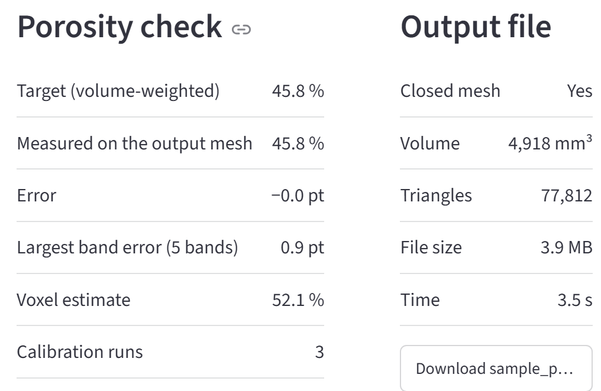

# User guide: Porous Structure Generator

This tool turns a closed STL model into a porous STL with the same outer shape.
The inside is filled with a gyroid lattice, and you choose how much of the volume is empty.

Porosity = (1 − output volume ÷ input volume) × 100.
50 % means half of the original volume is removed.

You can use the tool in two ways:

- **App**: a page in your web browser. Upload a file, move a slider, download the result.
- **Command line**: one command per file. Useful for many files or for scripts.

Both use the same engine and give the same result.

## Words used in this guide

| Word | Meaning |
|------|---------|
| Closed mesh (watertight) | A mesh with no holes or gaps in its surface. Only a closed mesh has a volume. |
| Point (pt) | A difference between two porosities. 49 % against a target of 50 % is an error of −1 pt. A minus error means less empty space than the target. |
| Voxel | A small cube. The engine first turns the model into many small cubes, then makes the lattice from them. |
| Voxel pitch | The side length of one voxel. |
| Cell size | The length of one repeat of the gyroid pattern. It sets the size of the pores. |
| Skin | A solid outer wall with no pores. |
| Uniform / Graded | Uniform: the same porosity everywhere. Graded: the porosity changes from one end of the model to the other. |

## 1. Install

You need:

- Windows, macOS or Linux
- Python 3.14 (https://www.python.org/downloads/)
- Git, or GitHub Desktop

### Get the files

With GitHub Desktop: **File → Clone repository → URL**, paste
`https://github.com/susi0099/porous-generator.git`, choose a folder and press **Clone**.

With Git, in a terminal:

```
git clone https://github.com/susi0099/porous-generator.git
```

### Set up Python

Open a terminal **in the `porous-generator` folder**. On Windows, open the folder in
Explorer, right-click an empty space and choose **Open in Terminal**.
In VS Code, use **File → Open Folder**, then **Terminal → New Terminal**.

Then run (Windows, PowerShell):

```
py -3.14 -m venv .venv
.venv\Scripts\Activate.ps1
pip install -r requirements.txt
```

On macOS or Linux:

```
python3.14 -m venv .venv
source .venv/bin/activate
pip install -r requirements.txt
```

`.venv` is a separate Python environment only for this tool.
When it is active, the line in the terminal starts with `(.venv)`.
**Every time you open a new terminal**, go to the `porous-generator` folder and
run `.venv\Scripts\Activate.ps1` again. You do not need to run `pip install` again.

If PowerShell says that running scripts is disabled, run this once and try again:

```
Set-ExecutionPolicy -Scope CurrentUser RemoteSigned
```

## 2. Use the app

In the `porous-generator` folder, with `(.venv)` active:

```
streamlit run app.py
```

The browser opens at http://localhost:8501. If it does not open, type this address
into your browser. Keep the terminal open while you use the app.
To stop the app, press Ctrl + C in the terminal.



1. **Model**: upload your STL file in the left sidebar. The size, volume, number of triangles
   and "Closed mesh" are shown. Check that "Closed mesh" is **Yes** and that the size
   in millimetres looks right.
2. **Porosity**: choose **Uniform** and set the target, or choose **Graded**,
   choose the axis and set the porosity at each end (section 4).
3. **Advanced** (optional): cell size, voxel pitch and skin. The defaults work for most models.
4. Press **Generate**. A progress bar is shown. Small models take a few seconds.
5. Read the two tables.
   - **Porosity check**: the target, the porosity measured on the output mesh, and the error.
     For graded porosity, also the largest error of the 5 bands (section 4).
   - **Output file**: whether the mesh is closed, its volume, triangles, file size and time.
   - The line "Settings used" below the tables shows the settings of this result.
6. Press **Download** to save `<name>_porous.stl`.
7. Open the file in your slicer (for example PrusaSlicer) and check it before printing.

**The result changes only when you press Generate.** If you move a slider or change a setting,
press Generate again. If you upload a new file, the old result is cleared.

## 3. Use the command line

In the `porous-generator` folder, with `(.venv)` active:

```
python -m porous models/cube30.stl --porosity 50
python -m porous models/sample.stl --graded Z 20 80 --out outputs/cow_graded.stl
python -m porous models/pyramid40.stl --porosity 65 --skin 0.5
```

The first line makes `cube30.stl` 50 % porous.
The second makes the cow model (`sample.stl`) 20 % porous at the bottom and 80 % at the top.
The third makes a pyramid 65 % porous with a 0.5 mm skin.

| Option | Meaning | Default |
|--------|---------|---------|
| `--porosity P` | uniform porosity in % | use this or `--graded` |
| `--graded AXIS P_MIN P_MAX` | graded porosity along X, Y or Z | |
| `--cell C` | cell size in mm | 6 |
| `--pitch D` | voxel pitch in mm | 0.5 |
| `--skin S` | skin thickness in mm | 0 |
| `--out PATH` | where to save the output STL | `outputs/<name>_porous.stl` |

The command prints one line, for example:

```
target 50.0 / measured 49.1 / error -0.9 / iterations 3 / 3.5 s -> outputs\cube30_porous.stl
```

"measured" is the porosity measured on the output STL. "iterations" is how many times
the engine adjusted itself to reach the target.
A JSON file with all settings and results is saved next to the STL.

To check an output yourself, use the checker. It measures only the two STL files
and does not trust the numbers the engine prints:

```
python tools/check_stl.py models/cube30.stl outputs/cube30_porous.stl --porosity 50
```

## 4. Settings and recommended values

The recommended values come from our tests (`results/summary.csv`, 38 cases, all passed).
Times were measured on our laptop and change a little from run to run.

### Porosity

- You can request **5 to 85 %**.
- The porosity measured on the output is normally within **1 pt** of the target.

### Graded porosity

The porosity changes in a straight line along the axis you choose.
P_MIN is used at the lowest end of the model along that axis, and P_MAX at the highest end.
Z is the height of the model when it stands on the print bed.
For example, `Z 20 80` gives 20 % at the bottom and 80 % at the top.

The target shown for the whole model is the average over its volume.
For a cube, 20 → 80 % gives 50 %. The cow has more volume near the bottom,
where the porosity is low, so its target is 45.8 %.

To check the change, the model is cut into **5 slices of equal height** along the axis,
and the porosity of each slice is measured. "Largest band error" is the largest error
among these 5 slices. Our limit is 5 pt; our tests gave 0.9 pt at most.

### Cell size (default 6 mm)

A bigger cell makes bigger pores and thicker walls, and a smaller file.

| Cell | Error (cube30, 50 %) | File size |
|------|----:|----:|
| 4 mm | +0.8 pt | 14.9 MB |
| 6 mm | −0.9 pt | 10.3 MB |
| 8 mm | +0.1 pt | 7.9 MB |

Use **6 mm**. A part of the model that is thinner than one cell gets only one or two pores
and can break away. For such parts, add a skin (below) or use a smaller cell.

### Voxel pitch (default 0.5 mm)

Every pitch we tested keeps the error within 1 pt,
but a smaller pitch makes the file much bigger and the run slower.

| Pitch | Error (cube30, 50 %) | Time | File size |
|-------|----:|----:|----:|
| 0.8 mm | −0.6 pt | 1.3 s | 4.2 MB |
| 0.5 mm | −0.9 pt | 4.2 s | 10.3 MB |
| 0.3 mm | +0.1 pt | 9.4 s | 27.7 MB |

Use **0.5 mm**. Use 0.3 mm only for small models with fine details.
Use 0.8 mm or more for large models.

### Skin (default 0 mm)

The skin keeps thin parts and the outer surface of the model.

- With no skin, thin parts such as the cow's ears and horns can be lost at high porosity.
  For the cow at 65 %, the outer size changed by 1.91 mm with no skin
  and by 0.30 mm with a 0.5 mm skin.
- Use **0.5 mm** for models with thin parts, or when you want a smooth outer surface.
- A thick skin takes a lot of volume, so a high porosity may become impossible.
  Then the app shows "The target could not be reached exactly". Use a thinner skin
  or a lower porosity.

## 5. Input STL

- The mesh must be **closed**. If not, you get
  "Input STL is not watertight. Please repair the mesh." Repair it in your CAD tool or a mesh
  repair tool, and export the STL again.
- The units must be **millimetres**. Check the size shown in the sidebar. If a 30 mm part shows
  as 0.03 mm or 30000 mm, scale it in your CAD tool before exporting.
- The app accepts files up to 200 MB.

## 6. Limits and cautions

- **Large models take time.** The time and memory grow with (size ÷ pitch)³:
  a model twice as large takes about eight times longer.
  If the model needs more than 50 million voxels, you get
  "Model too large: increase the voxel pitch." At pitch 0.5 mm this is about a 180 mm cube.
  Try a large model with a large pitch first.
- **High porosity makes thin walls.** At 80 % the walls may be too thin for a 0.4 mm nozzle.
  In the slicer preview, check that the lines are not broken.
- **Always check in your slicer before printing.** Our test outputs open in PrusaSlicer without
  warnings, but every model is different.
- Only the gyroid pattern is available.

## 7. Troubleshooting

| Problem | What to do |
|---------|------------|
| `streamlit` or `python` is not recognized | Go to the `porous-generator` folder and run `.venv\Scripts\Activate.ps1` |
| `No module named ...` | Run `pip install -r requirements.txt` with `(.venv)` active |
| `Input STL is not watertight` | Repair the mesh and export it again (section 5) |
| `Model too large: increase the voxel pitch.` | Use a larger pitch, for example 0.8 mm |
| "The target could not be reached exactly" | Use a thinner skin or a lower porosity |
| The result does not change after I move a slider | Press Generate again |
| The output file cannot be saved (PermissionError) | Close the file if it is open in another program |

## 8. Example files

`examples/` has six output files (cube and cow, uniform and graded) with their measured
porosity. See `examples/README.md`.
